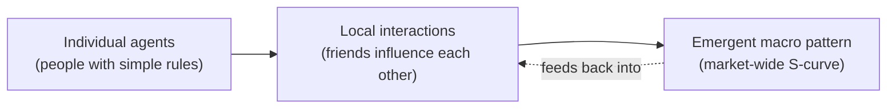
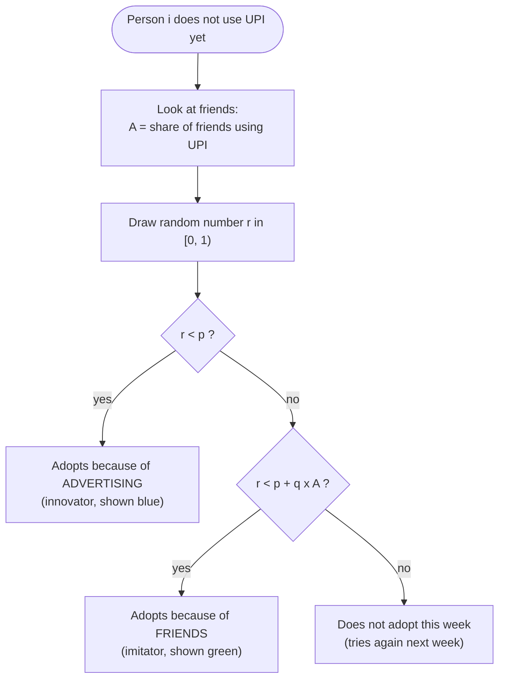
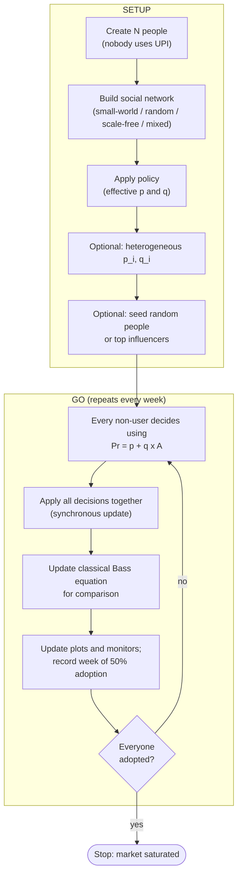
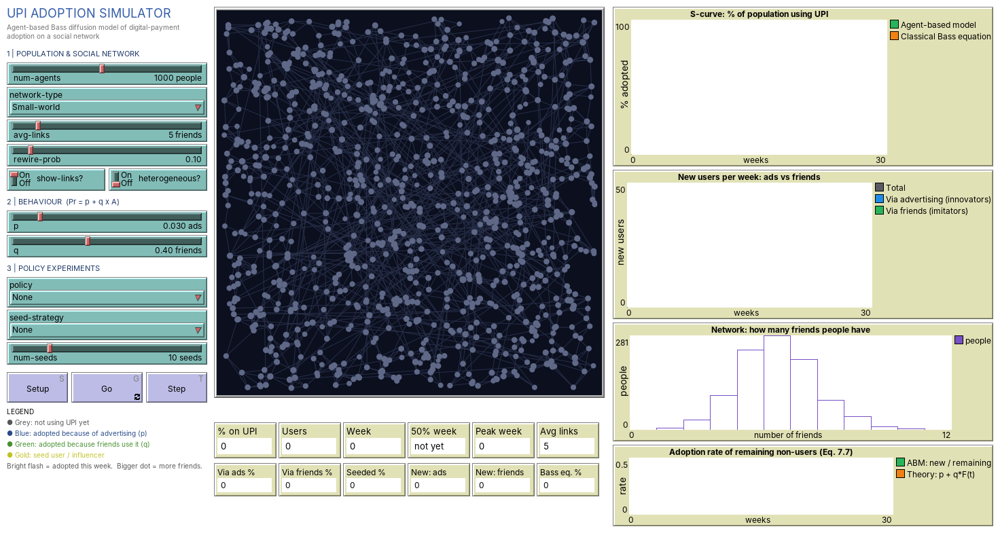
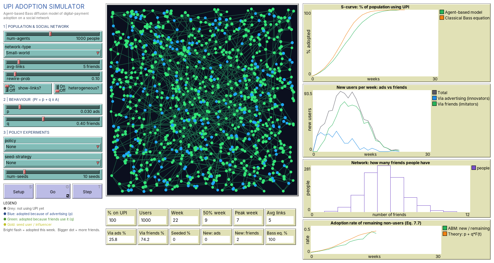
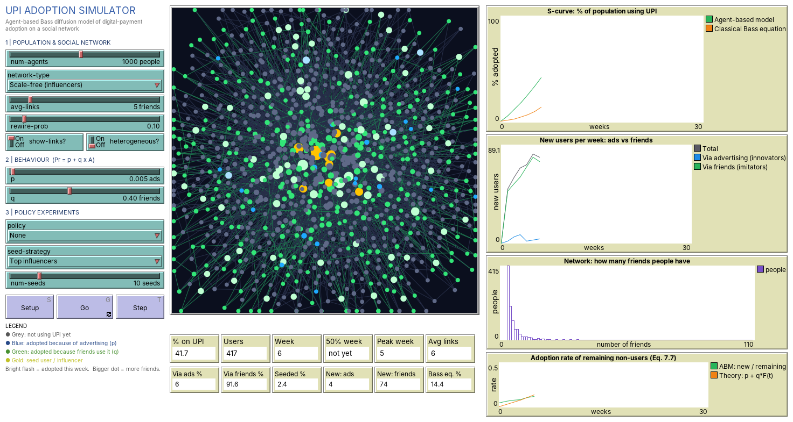
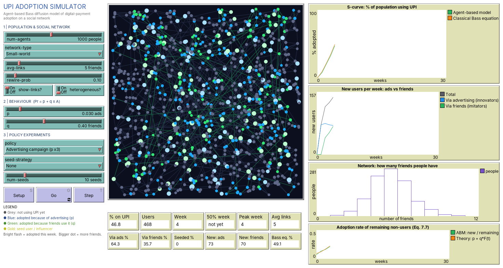
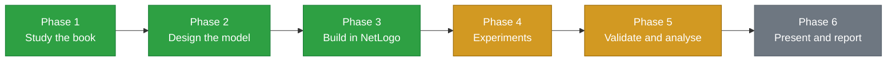

# UPI Adoption Simulator — Agent-Based Modeling in Economics

> An agent-based simulation, built in NetLogo, of how a new technology (UPI / digital payments) spreads through a society of interacting people, and of how advertising, word-of-mouth, social networks and policy change the speed of adoption.

[](#16-project-roadmap)
[](https://ccl.northwestern.edu/netlogo/)
[](#4-what-is-agent-based-modeling)
[](#7-the-economic-model)
[](#2-academic-details)
[](#20-references)

* * *

1. [Overview](#1-overview)
2. [Academic Details](#2-academic-details)
3. [Problem Statement](#3-problem-statement)
4. [What is Agent-Based Modeling?](#4-what-is-agent-based-modeling)
5. [Our Solution](#5-our-solution)
6. [Project Type and Tech Stack](#6-project-type-and-tech-stack)
7. [The Economic Model](#7-the-economic-model)
8. [Agents, Environment and Rules](#8-agents-environment-and-rules)
9. [Social Networks](#9-social-networks)
10. [Model Workflow](#10-model-workflow)
11. [Simulation Interface](#11-simulation-interface)
12. [Screenshots](#12-screenshots)
13. [Experiments](#13-experiments)
14. [Results](#14-results)
15. [Mapping to the Reference Book](#15-mapping-to-the-reference-book)
16. [Project Roadmap](#16-project-roadmap)
17. [Repository Structure](#17-repository-structure)
18. [How to Run](#18-how-to-run)
19. [Assumptions, Limitations and Future Scope](#19-assumptions-limitations-and-future-scope)
20. [References](#20-references)

* * *

> **Project status:** The NetLogo simulation is **complete and working** (tested in NetLogo 6.4). Policy, network and influencer-seeding experiments have been run, and their results are below. The remaining work is parameter sweeps, validation against real data, and the final report. See the [roadmap](#16-project-roadmap).


## 1. Overview

| Item | Description |
|---|---|
| **Project name** | UPI Adoption Simulator |
| **Subject area** | Agent-Based Modeling (ABM) in Economics |
| **Economic question** | Why does a new technology spread slowly, then suddenly take off, then saturate? |
| **What we built** | An interactive agent-based simulation of 1,000 people on a social network |
| **Core model** | Agent-based Bass diffusion model (reference book, Ch. 7.3.4, Eq. 7.9) |
| **Case study** | UPI / digital-payment adoption in India |
| **Key output** | Week in which 50% of the population uses UPI; shape of the S-curve |
| **Key finding** | Seeding the top 10 influencers makes the market reach 50% adoption **2× faster** |

**Core principle:** we never write an equation for the whole market. We program simple rules for *one* person, and the market-wide adoption curve **emerges** from the interactions of 1,000 such people.

## 2. Academic Details

| Field | Details |
|---|---|
| **College** | Faculty of Technology, University of Delhi |
| **Course** | B.Tech Computer Science Engineering |
| **Year** | 2nd Year |
| **Semester** | Semester 3 |
| **Subject** | Agent-Based Modeling in Economics |
| **Reference book** | Delli Gatti, D., Fagiolo, G., Gallegati, M., Richiardi, M. & Russo, A. (eds.), *Agent-Based Models in Economics: A Toolkit*, Cambridge University Press, 2018 |

## 3. Problem Statement

> **Why do new products and technologies (like UPI, smartphones or electric vehicles) spread slowly at first, then suddenly take off, and finally saturate? And how do advertising, word-of-mouth and the structure of people's social connections change how fast this happens?**

Mainstream economics answers this with an **aggregate equation**, the classical Bass model (1969), which assumes:

| Assumption of the classical model | Why it is unrealistic (reference book, Ch. 1, 2, 7) |
|---|---|
| Everyone is identical (a "representative agent") | Real people are **heterogeneous**: some are early adopters, some are sceptics |
| Everyone is influenced by the whole population | People are influenced mostly by their **own friends and neighbours** |
| Agents are fully rational | Real people have **limited information** and use **simple rules of thumb** |
| No network structure | Who is connected to whom matters, e.g. **influencers** |

Because of these assumptions, an aggregate equation **cannot answer** questions like:

- How does adoption spread **through a social network**, cluster by cluster?
- Does it help to give the product first to **influencers**?
- Which **policy** works better: more advertising, or referral cashback?

## 4. What is Agent-Based Modeling?

An **Agent-Based Model (ABM)** is a computer simulation in which many individual decision-makers (**agents**) follow simple rules and interact with each other and with their environment. Aggregate patterns such as prices, crises or adoption curves are not assumed. They **emerge** from the bottom up.



| Mainstream approach | Agent-based approach |
|---|---|
| Top-down: one equation for the whole economy | Bottom-up: rules for each individual |
| Representative agent | Many heterogeneous agents |
| Full rationality, optimisation | Bounded rationality, heuristics, learning |
| Interaction only through prices | Direct interaction through networks |
| Equilibrium is assumed | Dynamics and equilibrium emerge from simulation |

## 5. Our Solution

We build an **agent-based version of the Bass diffusion model** in NetLogo and extend it beyond the book's example.

| Feature | Description |
|---|---|
| **1,000 interacting agents** | Each person decides independently every week whether to adopt UPI |
| **Four social networks** | Small-world (the book's case), random, scale-free (influencers), fully mixed (= the classical equation) |
| **Live comparison with the classical equation** | The aggregate Bass equation is plotted next to the ABM in real time |
| **Innovators vs. imitators** | Each adopter is coloured by *why* they adopted: ads (blue) or friends (green) |
| **Heterogeneous agents** | Optional personal values `p_i`, `q_i` for every agent |
| **Policy experiments** | Advertising campaign (p × 3), referral cashback (q × 2), both together |
| **Seeding strategies** | Give UPI first to random people or to the top influencers |
| **Built-in experiments** | Seven BehaviorSpace experiments (E1–E7) for sensitivity analysis |

## 6. Project Type and Tech Stack

> **This project is a simulation.** It is not a website or a mobile app. It is an interactive NetLogo model that runs on a computer and is explored through sliders, buttons, a live animated view and plots.

| Component | Technology |
|---|---|
| Modelling language and environment | **NetLogo 6.4** (agent-based programmable modelling environment) |
| Experiments and sensitivity analysis | NetLogo **BehaviorSpace** |
| Result files | CSV (BehaviorSpace table output) |
| Version control | Git + GitHub |

## 7. The Economic Model

Every week, each person *i* who does not yet use UPI adopts with probability (book, **Eq. 7.9**):

$$
\Pr_{i,t}(\text{adopt}) = p + q \cdot A_{i,t}
$$

| Symbol | Name | Economic meaning | Default |
|---|---|---|---|
| `p` | Innovation coefficient | External influence: **advertising**, media, government campaigns | 0.03 |
| `q` | Imitation coefficient | Internal influence: **word-of-mouth**, peer pressure, social learning | 0.40 |
| `A(i,t)` | Local adoption share | Share of person *i*'s friends who already use UPI | — |
| `n` | Average degree | Average number of friends per person | 5 |
| `N` | Population | Number of agents | 1,000 |

*The defaults are the book's reference configuration and match typical empirical values (average p ≈ 0.03, q ≈ 0.38; Mahajan, Muller & Bass, 1995).*

For comparison, the **classical aggregate Bass model** (fully mixed population) is computed alongside the ABM:

$$
F(t+1) = F(t) + \big(1 - F(t)\big)\big(p + q\,F(t)\big)
$$

where *F(t)* is the share of the whole population that has adopted. The adoption rate among remaining non-users, `f(t) / (1 − F(t)) = p + qF(t)` (book, **Eq. 7.7**), is plotted live as well.

> **Scientific caveat:** p and q are set to values from the literature, not estimated from Indian UPI data. The model explains *mechanisms* (why and how adoption spreads). It does not forecast exact UPI user numbers. Calibrating to real data is part of the future work in the roadmap.

## 8. Agents, Environment and Rules

| ABM element | In our model |
|---|---|
| **Agents** | People (potential UPI users) |
| **State variables** | `adopted?` (true/false), `adopted-via` (ads / friends / seed), `p-i`, `q-i` |
| **Environment** | A social network linking each person to their friends |
| **Behavioural rule** | Adopt with probability `p + q·A` (heuristic, not optimisation) |
| **Time** | Discrete steps (1 tick = 1 week), **synchronous** update |
| **Randomness** | Each decision is a random draw; results are averaged over many runs |
| **Emergent output** | Market-level S-curve, adoption speed, innovator/imitator split |



## 9. Social Networks

Interaction structure matters (book, **Ch. 6**). The model offers four networks:

| Network | How it is built | Real-world meaning |
|---|---|---|
| **Small-world** *(default, as in the book)* | Each person links to their nearest neighbours, then 10% of links are rewired to random people (Watts–Strogatz idea) | Friends in your locality or hostel, plus a few distant relatives or college friends |
| **Random** | Links placed between random pairs (Erdős–Rényi) | No structure; some people end up with no friends at all |
| **Scale-free (influencers)** | Preferential attachment: newcomers prefer to link to popular people (Barabási–Albert) | A few big influencers with hundreds of followers |
| **Fully mixed (classical Bass)** | No links; everyone is influenced by the whole population | The assumption of the original aggregate equation |

## 10. Model Workflow



This is the **recursive structure of an AB model** from **Ch. 3** of the book, `x(i, t+1) = f( x(i,t), x(−i,t), θ, ξ(i,t) )`. Each agent's next state depends on its own state, its neighbours' states, the parameters θ = (p, q, n) and randomness ξ.

## 11. Simulation Interface

| Area | Contents |
|---|---|
| **Left panel: controls** | **1. Population and network:** `num-agents`, `network-type`, `avg-links`, `rewire-prob`, `show-links?`, `heterogeneous?` · **2. Behaviour:** `p`, `q` · **3. Policy experiments:** `policy`, `seed-strategy`, `num-seeds` · **Setup / Go / Step** buttons · colour legend |
| **Centre: live view** | Each dot is a person. **Grey** = not using UPI · **Blue** = adopted because of ads · **Green** = adopted because of friends · **Gold** = seeded influencer · bright flash = adopted this week · bigger dot = more friends |
| **Below the view: 12 monitors** | % on UPI, users, week, **week when 50% was reached**, peak week, average links, % of users via ads / friends / seeds, new users this week (ads, friends), classical Bass % |
| **Right panel: 4 plots** | (1) **S-curve**, ABM vs. classical Bass equation · (2) **new users per week**, innovators vs. imitators · (3) **degree distribution** of the network · (4) **adoption rate** of remaining non-users vs. theory `p + q·F(t)` |

## 12. Screenshots

*All screenshots were exported from the real, running NetLogo model.*

| Week 0: Setup | Week 7: Take-off | Week 22: Saturation |
|---|---|---|
|  |  |  |

| Scale-free network seeded with the top 10 influencers (gold, centre) | Policy: advertising campaign (p × 3) |
|---|---|
|  |  |

## 13. Experiments

All experiments are built into the model (**Tools → BehaviorSpace**). Each configuration is repeated many times and averaged, because the model is stochastic. This follows the **sensitivity analysis** method of **Ch. 7**.

| ID | Experiment | What varies | Runs | Status |
|---|---|---|---|---|
| E1 | Baseline S-curve | — (book reference values) | 50 | ⬜ To run |
| E2 | Advertising effect | `p` from 0.01 to 0.20 | 20 per value | ⬜ To run |
| E3 | Word-of-mouth effect | `q` from 0 to 1 | 20 per value | ⬜ To run |
| E4 | Connectivity effect | `avg-links` from 1 to 30 | 20 per value | ⬜ To run |
| E5 | Network structure | 4 network types | 30 each | ✅ Done |
| E6 | Policy comparison | 4 policies | 30 each | ✅ Done |
| E7 | Seeding strategy | none / random / influencers | 30 each | ✅ Done |

**Output statistic:** the week in which **50% of the population** uses UPI, the book's main output. Lower means faster adoption.

## 14. Results

Raw data: [`experiments/results/`](experiments/results)

### E6: Which policy works best?
*Small-world network, p = 0.03, q = 0.4, 30 runs each*

| Policy | Weeks to 50% adoption | Weeks until everyone adopts |
|---|---|---|
| None (baseline) | **8.3** | 25.9 |
| Advertising campaign (p × 3) | **4.9** | 17.9 |
| Referral cashback (q × 2) | **6.1** | 15.1 |
| Advertising + cashback | **4.0** | 10.5 |

> **Insight:** Advertising has the bigger effect on reaching the **first half** of the market. Cashback mainly shortens the **tail** (the last stragglers), because word-of-mouth becomes stronger as more friends adopt. Combining both is the fastest.

### E7: Who should get UPI first?
*Scale-free network, very low advertising (p = 0.005), 10 seeds, 30 runs each*

| Seed strategy | Weeks to 50% adoption |
|---|---|
| No seeding | **15.2** |
| 10 random people | **13.2** |
| 10 top influencers | **7.5** |

> **Insight:** Giving UPI first to the **10 most-connected people** makes the market reach 50% **twice as fast**, while 10 random people barely help. An aggregate equation cannot produce this policy insight, because it has no network.

### E5: Does the network structure matter?
*p = 0.03, q = 0.4, n = 5, 30 runs each*

| Network | Weeks to 50% | Weeks until everyone adopts |
|---|---|---|
| Fully mixed (classical Bass) | 7.5 | 21.4 |
| Scale-free (influencers) | 8.0 | 23.0 |
| Small-world | 8.2 | 30.6 |
| Random | 8.2 | 91.2 |

> **Insight:** All networks reach 50% at similar speeds, but the **tail** differs a lot. In a random network some people have **no friends at all**, so only advertising can reach them and they adopt very late. Local interaction slows full adoption compared with the classical "everyone sees everyone" assumption.

### Comparison with the reference book (Ch. 7.3.4)

| Book finding | Our model |
|---|---|
| Diffusion follows an S-shaped curve | ✅ Reproduced (qualitative output validation, Ch. 8) |
| Everyone eventually adopts when p > 0 | ✅ Reproduced in every run |
| p (external influence) strongly speeds adoption | ✅ Confirmed by E6 (advertising campaign) |
| Network structure changes adoption dynamics | ✅ Confirmed by E5 and E7 |

## 15. Mapping to the Reference Book

| Book chapter | Concept | Where it appears in our project |
|---|---|---|
| Ch. 1–2 | Economy as a complex system of heterogeneous interacting agents; emergence | The market-level S-curve emerges from individual decisions |
| Ch. 2.5 | Schelling's segregation model implemented in NetLogo | NetLogo is a standard ABM tool; same "simple rules, complex outcome" idea |
| Ch. 3 | ABMs as recursive systems `x(t+1) = f(x(t), …)` | The `go` procedure updates every agent's state each week |
| Ch. 4–5 | Bounded rationality, heuristics, social learning | Agents imitate friends instead of optimising |
| Ch. 6 | Local interaction and networks | Four network types connecting the agents |
| Ch. 7 | Bass diffusion with local interaction (Eq. 7.7, 7.9); sensitivity analysis | Core rule, rate plot, and experiments E1–E7 |
| Ch. 8 | Empirical validation | S-curve check; comparison with the book's findings |
| Ch. 9 | Estimation (simulated moments, Bayesian) | Future work: estimate p and q from real UPI data |

## 16. Project Roadmap



| Phase | Task | Status |
|---|---|---|
| **1. Literature study** | Ch. 1–2: what ABMs are, why economics needs them | ✅ Done |
| | Ch. 3: ABMs as recursive systems | ✅ Done |
| | Ch. 4–5: bounded rationality, heuristics, learning | ✅ Done |
| | Ch. 6: interaction and networks | ✅ Done |
| | Ch. 7: Bass diffusion with local interaction; sensitivity analysis | ✅ Done |
| | Ch. 8–9: validation and estimation (overview) | ✅ Done |
| **2. Model design** | Problem statement, agents, rules, parameters, outputs | ✅ Done |
| **3. Implementation** | Interface: 9 controls, 3 buttons, 12 monitors, 4 plots, legend | ✅ Done |
| | 4 network types, synchronous adoption rule, classical Bass benchmark | ✅ Done |
| | Heterogeneous agents, policies, seeding strategies | ✅ Done |
| | Testing in NetLogo 6.4 (GUI and headless) | ✅ Done |
| **4. Experiments** | BehaviorSpace experiments E1–E7 built into the model | ✅ Done |
| | E5 networks, E6 policies, E7 seeding: run and exported | ✅ Done |
| | E1 baseline, E2 vary p, E3 vary q, E4 vary friends | ⬜ To do |
| | Charts of averaged results for the report | ⬜ To do |
| **5. Validation** | Qualitative validation: S-curve reproduced | ✅ Done |
| | Comparison with the book's findings | ✅ Done |
| | Compare with real UPI adoption trends (Ch. 8) | ⬜ To do |
| **6. Presentation** | Live demo of the NetLogo model | ⬜ To do |
| | Final report | ⬜ To do |

## 17. Repository Structure

```
agent-based-modeling-in-economics/
├── README.md                              # Project documentation (this file)
├── model/
│   └── upi-adoption.nlogo                 # The NetLogo simulation: code, interface,
│                                          # Info tab and BehaviorSpace experiments
├── experiments/
│   └── results/
│       ├── E5-network-structure.csv       # Network comparison results
│       ├── E6-policy-comparison.csv       # Policy comparison results
│       └── E7-seeding-influencers.csv     # Seeding strategy results
└── screenshots/                           # Exported from the running model
    ├── 01-setup-small-world.png
    ├── 02-takeoff-small-world.png
    ├── 03-saturation-small-world.png
    ├── 04-influencers-scale-free.png
    └── 05-policy-advertising.png
```

## 18. How to Run

| Step | Action |
|---|---|
| 1 | Install **NetLogo 6.4** (free) from [ccl.northwestern.edu/netlogo](https://ccl.northwestern.edu/netlogo/). Newer NetLogo 7 versions can also open `.nlogo` files. |
| 2 | Download this repository (**Code → Download ZIP**) and extract it |
| 3 | Open `model/upi-adoption.nlogo` in NetLogo |
| 4 | Click **Setup**, then **Go**. Use **Step** to advance one week at a time |
| 5 | Change `p`, `q`, `network-type`, `policy` or `seed-strategy`, then click **Setup** and **Go** again |
| 6 | To reproduce the experiments: **Tools → BehaviorSpace →** select E1–E7 **→ Run** |
| 7 | Read the **Info** tab inside the model for full documentation |

**Suggested live demo**

1. Default settings → **Setup → Go**: slow start, take-off, saturation. The S-curve emerges.
2. Set `policy` to **Advertising campaign (p x3)**: 50% adoption comes much sooner.
3. Set `network-type` to **Scale-free**, `p` to 0.005, `seed-strategy` to **Top influencers**: watch adoption spread outward from the gold hubs.

## 19. Assumptions, Limitations and Future Scope

| Assumptions and limitations | Future scope |
|---|---|
| p and q are taken from the literature, not estimated from UPI data | Estimate p and q from real UPI data (book, Ch. 9: method of simulated moments) |
| Adoption is permanent (nobody stops using UPI) | Add dis-adoption and switching between payment apps |
| The network is static | Dynamic networks where friendships form and break (book, Ch. 6.4.2) |
| One homogeneous country-wide population | Urban/rural and age groups with different p and q |
| No cost or price of adoption | Add smartphone and internet access as adoption barriers |

## 20. References

1. Delli Gatti, D., Fagiolo, G., Gallegati, M., Richiardi, M. & Russo, A. (Eds.) (2018). *Agent-Based Models in Economics: A Toolkit*. Cambridge University Press.
2. Bass, F. M. (1969). A New Product Growth for Model Consumer Durables. *Management Science*, 15(5), 215–227.
3. Mahajan, V., Muller, E. & Bass, F. M. (1995). Diffusion of New Products: Empirical Generalizations and Managerial Uses. *Marketing Science*, 14(3).
4. Watts, D. J. & Strogatz, S. H. (1998). Collective dynamics of "small-world" networks. *Nature*, 393, 440–442.
5. Barabási, A.-L. & Albert, R. (1999). Emergence of scaling in random networks. *Science*, 286, 509–512.
6. Wilensky, U. (1999). *NetLogo*. Center for Connected Learning and Computer-Based Modeling, Northwestern University.
